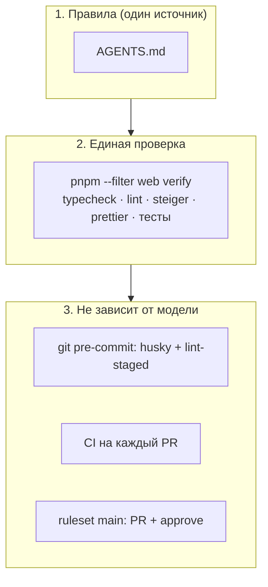

# ИИ-агенты: одни правила для всех вендоров

[← к README](../README.md)

В команде работают разные ИИ-инструменты — Claude Code, Codex, Gemini CLI, Cursor, Copilot. Чтобы все они
работали по одним правилам, обвязка устроена в три слоя: **правила** → **единая проверка** → **принудительные
проверки**, которые не зависят от модели.



## 1. Правила — только в `AGENTS.md`

[`AGENTS.md`](https://agents.md/) — открытый формат инструкций для агентов, его читают большинство инструментов.
Все правила пишем **только туда**: команды, критерий «готово», запреты, рабочий цикл, архитектура, дизайн-система.

| Инструмент                      | Что читает                                                            |
| ------------------------------- | --------------------------------------------------------------------- |
| OpenAI Codex                    | `AGENTS.md`                                                           |
| Cursor                          | `AGENTS.md` (и `.cursor/rules/`)                                      |
| GitHub Copilot (агент, VS Code) | `AGENTS.md` (и `.github/copilot-instructions.md` в корне репозитория) |
| Windsurf, Zed, Amp и др.        | `AGENTS.md`                                                           |
| Claude Code                     | свой `CLAUDE.md`                                                      |
| Gemini CLI                      | свой `GEMINI.md` (имя настраивается)                                  |

**Адаптеров для Claude Code и Gemini CLI пока нет.** Сами по себе эти инструменты `AGENTS.md` не подхватят,
поэтому первой фразой попросите агента прочитать `apps/web/AGENTS.md`. Если команда решит добавить адаптеры,
каждый из них — файл в одну строку, который подключает `AGENTS.md`: `CLAUDE.md` с `@AGENTS.md`, `GEMINI.md` с
`@./AGENTS.md`. Своих правил в адаптеры не пишем, иначе разные модели получат разные инструкции.

> Поддержка форматов у инструментов меняется. Подключили новый инструмент — проверьте в его документации, какой
> файл он читает, и добавьте строку в эту таблицу.

### Откуда запускать агента

Правила лежат в `apps/web`. Инструменты ищут файл инструкций от текущей папки и вверх до корня репозитория, а
вложенные файлы подхватывают по-разному. Надёжнее всего для задач фронтенда **запускать агента из `apps/web`**
(или открывать эту папку в IDE). Если запускаете из корня монорепы — первой фразой попросите прочитать
`apps/web/AGENTS.md`.

## 2. Единая проверка — `verify`

Формулировки «проверь, что всё работает» каждая модель понимает по-своему. Поэтому «готово» определено одной
командой с однозначным результатом:

```bash
pnpm --filter web verify   # typecheck + ESLint + steiger (FSD) + Prettier + Vitest
```

`AGENTS.md` требует запускать её перед завершением задачи и прикладывать итог к отчёту. Ревьюер может
повторить ту же команду и получить тот же результат.

## 3. Проверки, которые нельзя «уговорить»

Правила в тексте модель может неправильно понять или пропустить. Поэтому главное продублировано механизмами,
которые срабатывают независимо от того, кто пишет код — человек или любая модель:

| Механизм                             | Что ловит                                        | Где                                      |
| ------------------------------------ | ------------------------------------------------ | ---------------------------------------- |
| **pre-commit** (husky + lint-staged) | ESLint и Prettier по изменённым файлам           | `.husky/pre-commit`, `.lintstagedrc.mjs` |
| **steiger** в `lint`                 | нарушения слоёв FSD и публичного API             | `steiger.config.mjs`                     |
| **TypeScript strict**                | `any`, непроверенные `null`, неверные типы       | `tsconfig.json`                          |
| **MSW в строгом режиме**             | тесты, которые ходят в сеть                      | `vitest.setup.ts`                        |
| **CI**                               | всё то же самое на каждый PR + сборка + lockfile | `.github/workflows/ci.yml`               |
| **Ruleset `main`**                   | прямые пуши, PR без approve                      | настройки GitHub                         |

Нашли повторяющуюся ошибку агентов — сначала подумайте, можно ли поймать её **проверкой** (правило ESLint, тест,
настройка steiger), и только если нельзя — дописывайте правило в `AGENTS.md`.

## Как менять правила

- Правило касается всех моделей → `AGENTS.md`.
- Правило меняет то, что описано в `docs/`, → обновите и гайд, и `AGENTS.md` в одном PR.
- Блоки `<!-- BEGIN:nextjs-… -->` в `AGENTS.md` пишет сам `next dev` — не удаляйте их, коммитьте как есть.
  Блок `nextjs-agent-feedback` появляется из-за `experimental.agentFeedback` в `next.config.ts` и просит агентов
  отправлять отзывы о Next.js в Vercel; если команде это не нужно — выключите опцию.
