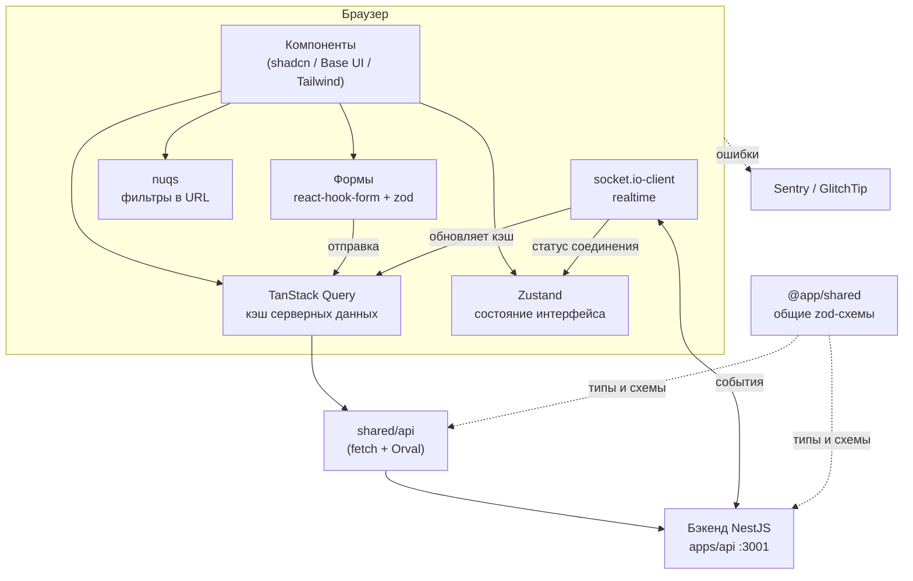

# Архитектура фронтенда

[← к README](../README.md)

## Feature-Sliced Design за 5 минут

[Feature-Sliced Design](https://feature-sliced.design/ru/) (FSD) — договорённость о том, **куда класть код**,
чтобы проект не превратился в свалку из `components/` и `utils/`. Код делится на **слои**
(сверху вниз — от «склейки приложения» к переиспользуемым кирпичикам):

| Слой       | Что лежит                                                                   | Пример у нас                                        |
| ---------- | --------------------------------------------------------------------------- | --------------------------------------------------- |
| `_app`     | Всё, что нужно приложению целиком: лейауты, глобальные стили, провайдеры    | `layouts/root-layout.tsx`, `api/query-provider.tsx` |
| `_pages`   | Страницы: собирают виджеты и фичи в экран                                   | `landing`, `login`, `register`                      |
| `widgets`  | Крупные самостоятельные блоки интерфейса                                    | `site-header`, `site-footer`                        |
| `features` | Действия пользователя, которые приносят ценность                            | `auth` (вход/регистрация), `theme-toggle`           |
| `entities` | Бизнес-сущности: пользователь, канал, сообщение, задача                     | пока нет — появятся с первыми фичами чата           |
| `shared`   | Переиспользуемое **без бизнес-логики**: UI-кит, утилиты, клиент API, конфиг | `ui/button.tsx`, `lib/utils.ts`, `api/`             |

> `app` и `pages` в FSD у нас называются `_app` и `_pages`: папку `src/pages` Next.js принял бы за свой
> старый роутер (Pages Router) и сборка бы упала. Так рекомендует [гайд FSD для Next.js](https://feature-sliced.design/docs/guides/tech/with-nextjs).

Слой делится на **слайсы** (`features/auth`, `features/theme-toggle`), а слайс — на **сегменты** по назначению:

| Сегмент  | Что внутри                                 |
| -------- | ------------------------------------------ |
| `ui`     | React-компоненты                           |
| `model`  | Состояние, схемы валидации, хуки с логикой |
| `api`    | Запросы к бэкенду                          |
| `lib`    | Вспомогательные функции этого слайса       |
| `config` | Константы, настройки                       |

### Три правила, которые проверяет линтер

1. **Импорт только вниз.** Слой может импортировать только из слоёв ниже себя.
   `features` → `shared` можно, `shared` → `features` нельзя.
2. **Слайсы одного слоя друг о друге не знают.** `features/auth` не импортирует `features/theme-toggle`.
   Нужно объединить две фичи — делайте это слоем выше (в виджете или странице).
3. **Только через публичный API.** Снаружи слайса импортируем из его `index.ts`:
   `import { LoginForm } from "@/features/auth"`, а не `@/features/auth/ui/login-form`.
   Внутри слайса — относительные импорты (`./auth-header`, `../model/schemas`).

В `shared` слайсов нет: `@/shared/ui/button`, `@/shared/lib/utils` — нормально.
`shared/api` и `shared/config` импортируются через свои `index.ts`: `@/shared/api`, `@/shared/config`.

Правила проверяет [steiger](https://github.com/feature-sliced/steiger) в `pnpm lint` — ошибки FSD ломают CI.

### Куда положить новый код?

```
Это кнопка/инпут/модалка без бизнес-смысла?       → shared/ui      (через `shadcn add`)
Это утилита без бизнес-смысла (форматтер, хелпер)? → shared/lib
Это запрос к бэкенду / сгенерированный клиент?     → shared/api
Это «вещь» предметной области (сообщение, задача)
  и её отображение без действий (карточка, аватар)? → entities/<сущность>
Это действие пользователя (отправить сообщение,
  переместить задачу, войти)?                       → features/<действие>
Это блок, собранный из нескольких фич/сущностей
  (шапка, сайдбар каналов, лента сообщений)?        → widgets/<блок>
Это целый экран?                                    → _pages/<страница> + роут в app/
```

Не уверены — кладите ниже (ближе к `shared`) и поднимайте, когда появится второй потребитель.
Steiger подскажет, если слайс используется только в одном месте (`insignificant-slice`).

## Структура папок

```
apps/web/
├── app/                      # ТОЛЬКО роутинг Next.js — каждый файл в одну строку
│   ├── layout.tsx            #   export { RootLayout as default, metadata } from "@/_app"
│   ├── (marketing)/          #   группа роутов с шапкой и подвалом сайта
│   └── (auth)/login, register
├── src/                      # весь код приложения, по слоям FSD
│   ├── _app/                 # лейауты, глобальные стили, провайдеры
│   ├── _pages/
│   ├── widgets/
│   ├── features/
│   └── shared/
│       ├── ui/               # компоненты shadcn — UI-кит
│       ├── lib/              # cn() и другие утилиты
│       ├── config/           # переменные окружения
│       └── api/              # клиент бэкенда; generated/ — от Orval, руками не править
│           └── mocks/        # MSW-обработчики для тестов
├── e2e/                      # тесты Playwright
├── .storybook/               # конфиг Storybook
├── instrumentation*.ts       # Sentry (Next требует эти файлы в корне)
└── docs/                     # эта документация
```

### Почему `app/` отдельно от `src/`

`app/` — это роутер Next.js: структура папок = URL. В нём **нет логики и разметки**, только реэкспорт:

```ts
// app/(auth)/login/page.tsx
export { LoginPage as default, metadata } from "@/_pages/login";
```

Так страницы живут по правилам FSD, а Next видит то, что ему нужно. Новая страница = слайс в `src/_pages`

- однострочный файл в `app/`.

Группы в скобках — `(marketing)`, `(auth)` — не попадают в URL, они только выбирают лейаут.

Алиас `@/` указывает на `src/`: `@/shared/ui/button` → `src/shared/ui/button.tsx`.

## Как всё связано



Пример: пользователь открывает канал.

1. Страница рендерит виджет ленты; он вызывает хук запроса сообщений (TanStack Query).
2. Хук вызывает функцию из `shared/api` (сгенерированную Orval), она идёт на бэкенд с cookie сессии.
3. Ответ проверяется zod-схемой и кладётся в кэш; лента рисует его через виртуализированный список.
4. Пока канал открыт, по WebSocket приходят новые сообщения — обработчик события дописывает их в тот же кэш,
   и лента обновляется сама.
5. Выбранный тред, открытая панель, черновик — состояние интерфейса в Zustand; фильтры поиска — в URL через nuqs.

Подробно о том, что где хранить, — в [Состояние и данные](./state-and-data.md).

## Монорепа

```
monorepo-app/
├── apps/web          # этот фронтенд
├── apps/api          # бэкенд NestJS
└── packages/shared   # @app/shared — zod-схемы и типы, общие для фронта и бэка
```

- **pnpm workspaces** связывают пакеты: `"@app/shared": "workspace:^"` — это ссылка на папку, а не пакет из npm.
  Изменили `packages/shared` — фронтенд видит изменения сразу.
- **Turborepo** запускает задачи (`dev`, `build`, `lint`, `typecheck`) во всех пакетах и кэширует результат.
- `@app/shared` отдаёт исходники TypeScript, поэтому в `next.config.ts` он указан в `transpilePackages`.
