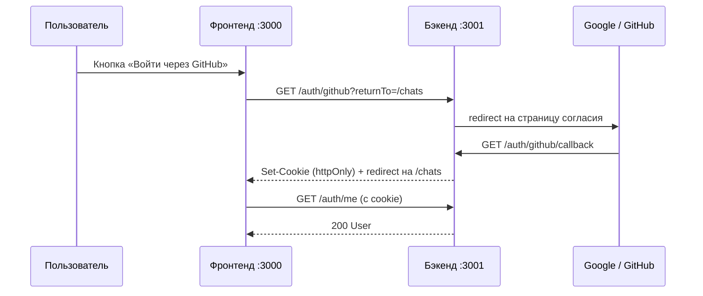

# Авторизация

[← к README](../README.md)

Вход через **Google** и **GitHub** (OAuth). Весь OAuth и сессию ведёт **бэкенд**: фронтенд только отправляет
пользователя на бэкенд и потом спрашивает «кто я».

> Окончательное решение по архитектуре авторизации ещё не принято. Если команда выберет Auth.js в Next.js,
> меняются только `features/auth/lib/oauth.ts` и `shared/api/session.ts`, кнопки и формы остаются.

## Как проходит вход

Ошибка входа — бэкенд возвращает на `/login?error=<код>`, и под кнопками появляется текст ошибки.

## Где код

| Что                                                  | Где                                                           |
| ---------------------------------------------------- | ------------------------------------------------------------- |
| Список провайдеров                                   | `src/features/auth/config/providers.ts`                       |
| Ссылки на бэкенд, проверка `returnTo`, тексты ошибок | `src/features/auth/lib/oauth.ts`                              |
| Кнопки провайдеров                                   | `src/features/auth/ui/oauth-buttons.tsx`                      |
| Иконки (в lucide брендов нет)                        | `src/features/auth/ui/provider-icons.tsx`                     |
| «Кто я», выход                                       | `src/shared/api/session.ts`, `use-session.ts`                 |
| Хук выхода                                           | `src/features/auth/model/use-logout.ts`                       |
| Формы входа и регистрации по email                   | `src/features/auth/ui/*-form.tsx`, схемы — `model/schemas.ts` |

Добавить провайдера: строка в `providers.ts` + иконка в `provider-icons.tsx` + эндпоинты на бэкенде.

## Контракт с бэкендом

| Запрос                                      | Что делает бэкенд                                                                                                                                  |
| ------------------------------------------- | -------------------------------------------------------------------------------------------------------------------------------------------------- |
| `GET /auth/{google\|github}?returnTo=/path` | redirect на страницу согласия провайдера                                                                                                           |
| `GET /auth/{provider}/callback`             | успех: httpOnly-cookie сессии + redirect на `{WEB}{returnTo}`; ошибка: redirect на `{WEB}/login?error=access_denied\|oauth_failed\|account_exists` |
| `GET /auth/me`                              | `200` + `User` из `@app/shared` или `401`                                                                                                          |
| `POST /auth/logout`                         | сбросить cookie, `2xx`                                                                                                                             |

Что нужно от бэкенда:

- **CORS** для `http://localhost:3000` с `credentials: true` — иначе браузер не отправит cookie.
- **Проверять `returnTo`** — только относительные пути своего фронтенда, иначе это open redirect.
  Фронтенд тоже чистит `returnTo` (`safeReturnTo`), но доверять клиенту нельзя. Проверять нужно разбором
  URL, а не строкой: `/\evil.com` и `/<таб>/evil.com` браузер превращает в `//evil.com` — чужой домен.
- **Имя и email при регистрации** проверяются по тем же правилам, что и `UserSchema` в `@app/shared`
  (имя от 2 символов). Поменяли схему на бэкенде — обновите `model/schemas.ts`, иначе упадёт тест.

При выходе (`useLogout`) фронтенд стирает весь кэш TanStack Query, кроме сессии (её ставит в `null`): данные
прошлого пользователя не должны достаться следующему на том же устройстве.

- Cookie с `SameSite=Lax`: `localhost:3000` и `localhost:3001` — один сайт. В production фронтенд и API —
  поддомены одного домена.

## Почему так

- **Токены не попадают в JavaScript.** Сессия в httpOnly-cookie: даже если на страницу внедрят вредоносный
  скрипт, он не прочитает токен. ТЗ требует, чтобы токены и секреты не попадали во фронтенд.
- **Один источник сессий** — бэкенд, который проверяет права и в HTTP, и в WebSocket.
