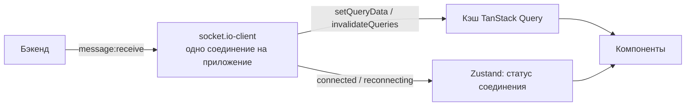

# Состояние и данные

[← к README](../README.md)

ТЗ прямо требует разделять **состояние интерфейса**, **данные с сервера** и **состояние WebSocket-соединения**.
Самая частая ошибка — складывать всё в один store. Ниже — куда что класть.

## Шпаргалка

| Что храним                                          | Где                           | Пример                                                 |
| --------------------------------------------------- | ----------------------------- | ------------------------------------------------------ |
| Данные с бэкенда                                    | **TanStack Query**            | сообщения, каналы, задачи, профиль, текущая сессия     |
| Состояние интерфейса, нужное нескольким компонентам | **Zustand**                   | открытый тред, свёрнутый сайдбар, черновики сообщений  |
| Состояние WebSocket                                 | **Zustand** (отдельный store) | `connected` / `reconnecting` / `offline`               |
| То, чем хочется поделиться ссылкой                  | **URL через nuqs**            | фильтры поиска и доски, открытая задача `?task=MSG-42` |
| Значения полей формы                                | **react-hook-form**           | поля входа, создания задачи                            |
| Локальное состояние одного компонента               | **`useState`**                | открыт ли выпадающий список, показан ли пароль         |

Если сомневаетесь, задайте себе вопросы по порядку:

1. Это пришло с сервера? → TanStack Query. **Никогда не копируйте серверные данные в Zustand** — получите два
   источника правды, и они разойдутся.
2. Это должно пережить перезагрузку страницы или открываться по ссылке? → URL (nuqs).
3. Это поле формы? → react-hook-form.
4. Это нужно только одному компоненту? → `useState`.
5. Иначе → Zustand.

## TanStack Query — данные с сервера

TanStack Query — это **кэш**. Компонент не «загружает данные», а говорит «мне нужны данные с таким ключом»;
библиотека сама решает, взять их из кэша или сходить на сервер, и обновляет все компоненты с этим ключом.

```ts
// Образец: src/shared/api/use-session.ts
export const sessionQueryKey = ["session"] as const;

export function useSession() {
  return useQuery({ queryKey: sessionQueryKey, queryFn: fetchSession });
}
```

- `queryKey` — адрес данных в кэше. Держите ключи рядом с запросом и экспортируйте: по ним кэш обновляют
  из других мест (`queryClient.setQueryData(sessionQueryKey, null)` при выходе — см. `features/auth/model/use-logout.ts`).
- Изменения на сервере — через `useMutation`. Для чата и доски используйте **оптимистичные обновления**:
  сразу показываем результат, при ошибке откатываем и показываем тост с «Повторить» (требование ТЗ).
- Когда на бэкенде появится Swagger, запросы и хуки будут **генерироваться Orval** в `src/shared/api/generated`
  (`pnpm --filter web generate-api`). Ручные функции, как `fetchSession`, — пока генерации нет.

## WebSocket (socket.io) — realtime

Соединение ещё не реализовано. Договорённость, как его делать:



- **Одно соединение на всё приложение**, а не по одному на компонент.
- Событие с сервера **обновляет кэш TanStack Query** (`queryClient.setQueryData`), а не отдельный store:
  компоненты продолжают читать данные через свои хуки запросов.
- Статус соединения — в отдельном Zustand-store: по нему показываем «Переподключение…».
- После переподключения нужно догрузить пропущенные сообщения (требование ТЗ) — инвалидировать запросы открытых каналов.
- Имена событий — из `@app/shared` (`SocketEvents.MESSAGE_RECEIVE`), а не строки в коде: так фронт и бэк не разойдутся.
- У отправляемого сообщения — id, сгенерированный на клиенте (`crypto.randomUUID()`): повторная отправка после
  ошибки сети не создаст дубль.

## Zustand — состояние интерфейса

Store — это маленький модуль в сегменте `model` того слайса, которому он принадлежит
(`features/thread/model/thread-store.ts`), а не один глобальный store на всё приложение.

```ts
import { create } from "zustand";

type ThreadStore = {
  openThreadId: string | null;
  openThread: (id: string) => void;
  closeThread: () => void;
};

export const useThreadStore = create<ThreadStore>()((set) => ({
  openThreadId: null,
  openThread: (id) => set({ openThreadId: id }),
  closeThread: () => set({ openThreadId: null }),
}));
```

Читайте из store только нужное поле — `useThreadStore((s) => s.openThreadId)`, — иначе компонент будет
перерисовываться на любое изменение store.

## nuqs — состояние в URL

```ts
import { parseAsString, useQueryState } from "nuqs";

const [assignee, setAssignee] = useQueryState("assignee", parseAsString);
// /board?assignee=me — фильтр переживает перезагрузку и открывается по ссылке
```

Адаптер `NuqsAdapter` уже подключён в корневом лейауте.

## Синхронизация вкладок

ТЗ требует: прочитали уведомление в одной вкладке — счётчик обновился в другой; закрыли одну вкладку — пользователь
не стал офлайн, если открыта вторая. Для этого есть встроенный в браузер `BroadcastChannel` — библиотека не нужна.

## Проверка данных: zod

- Данные **от пользователя** проверяем схемой формы (`features/*/model/schemas.ts`).
- Данные **от бэкенда** проверяем схемой ответа (`UserSchema.parse(...)` в `shared/api/session.ts`): если бэкенд
  поменял формат, ошибка будет понятной и сразу, а не `undefined` где-то в интерфейсе.
- Схемы запросов и ответов HTTP будут генерироваться Orval из `openapi.json` бэкенда, в `@app/shared` остаются только
  события WebSocket ([docs/architecture.md](../../../docs/architecture.md#контракт-фронтенд--бэкенд)). `UserSchema` из
  `@app/shared` — пример из шаблона, его заменит сгенерированная схема. Правила, нужные только интерфейсу (повтор
  пароля, «запомнить меня»), — во фронтенде.
