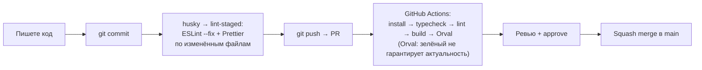

# Инструменты качества и CI

[← к README](../README.md)

## Что происходит с вашим кодом



## Линтеры и форматирование

| Инструмент     | Что проверяет                                                                         | Конфиг               | Запуск                        |
| -------------- | ------------------------------------------------------------------------------------- | -------------------- | ----------------------------- |
| **ESLint**     | Ошибки в коде, правила React и Next (хуки, `next/image`, доступность)                 | `eslint.config.mjs`  | `pnpm --filter web lint`      |
| **steiger**    | Архитектуру FSD: импорт только вниз, публичный API слайсов, лишние слайсы             | `steiger.config.mjs` | входит в `lint`               |
| **Prettier**   | Форматирование. Плагин Tailwind сортирует классы, в том числе внутри `cn()` и `cva()` | `.prettierrc.json`   | `pnpm --filter web format`    |
| **TypeScript** | Типы                                                                                  | `tsconfig.json`      | `pnpm --filter web typecheck` |

Настройте редактор: форматирование Prettier при сохранении и подсветка ESLint. Для VS Code — расширения
_Prettier_, _ESLint_ и _Steiger_ (FSD).

Что делать, если ругается steiger:

- `forbidden-imports` — импорт из слоя выше или из соседнего слайса. Поднимите код ниже или объедините
  слайсы на слое выше.
- `no-public-api-sidestep` — импорт в обход `index.ts`. Экспортируйте нужное из `index.ts` слайса.
- `insignificant-slice` — слайс используется только в одном месте. Возможно, его стоит слить с потребителем.

## Git-хук перед коммитом

`husky` (в корне монорепы) запускает `lint-staged`, тот для изменённых файлов `apps/web` выполняет
`eslint --fix` и `prettier --write` (конфиг — `apps/web/.lintstagedrc.mjs`). Если ESLint нашёл то, что не
исправить автоматически, коммит не создастся — исправьте ошибку и закоммитьте снова.

Хук ставится сам при `pnpm install`. Обходить его (`--no-verify`) не нужно: CI всё равно не пропустит.

## CI

`.github/workflows/ci.yml` запускается на каждый PR в `main`:

1. `pnpm install --frozen-lockfile` — падает, если `pnpm-lock.yaml` не соответствует `package.json`.
   Поставили пакет — закоммитьте и lockfile.
2. `pnpm typecheck`, `pnpm lint`, `pnpm build` — по всей монорепе.
3. Проверка, что клиент API от Orval не устарел относительно Swagger бэкенда. С ограничением: генерация запускается с подавлением ошибки (`generate-api || true`), поэтому если Swagger был недоступен и файлы не изменились, шаг всё равно зелёный. Пока на бэкенде нет Swagger, шаг ничего не проверяет. Как это исправить — [бэклог: контракт API](../../../docs/backlog/api-contract.md).

Правила команды ([Процесс работы](../../../docs/workflow.md#проверки-на-pr)) требуют, чтобы на каждом PR проходили линтинг, проверка FSD, тесты, проверка типов и сборка. **Тестов (`pnpm test`) и проверки Prettier в CI пока нет** — их нужно добавить ([бэклог](../../../docs/backlog/ci-checks.md)). До этого запускайте `pnpm --filter web verify` локально: он включает и тесты, и Prettier.

Формат сообщений коммитов и имён веток (ключ задачи Jira, типы коммитов) тоже нигде не проверяется автоматически — он описан в [Процессе работы](../../../docs/workflow.md#сообщения-коммитов).

## Orval — клиент API из Swagger

Бэкенд описывает эндпоинты через Swagger; Orval читает схему (`http://localhost:3001/api-json`) и генерирует
типы и хуки TanStack Query в `src/shared/api/generated`.

```bash
pnpm dev:api                       # бэкенд должен быть запущен
pnpm --filter web generate-api
```

- Сгенерированный код **не правим руками** — перезапишется. Он исключён из ESLint и Prettier.
- Сейчас генерация недоступна: на бэкенде ещё нет `@nestjs/swagger`. До его появления API-функции пишутся вручную, как `fetchSession` (см. [Состояние и данные](./state-and-data.md)).
- Когда появится Swagger, после изменения эндпоинтов перегенерируйте и закоммитьте клиент. Проверка в CI не гарантирует актуальность: генерация запускается с `|| true`, поэтому зелёный CI не подтверждает, что клиент свежий.

## Sentry / GlitchTip

Ошибки из браузера и с сервера Next уходят в Sentry (или совместимый GlitchTip), если задан `NEXT_PUBLIC_SENTRY_DSN`.
Локально переменную можно не задавать — SDK тогда выключен.

## Если что-то сломалось после установки пакетов

Симптомы: в `pnpm dev` ошибки вида `Could not find the module "…/next/dist/…" in the React Client Manifest`,
`Could not validate that a segment in your UI has instant navigation … Dropped segment`, хотя код не менялся.

Причина: pnpm создаёт отдельную копию пакета для каждого набора его peer-зависимостей. Поставили пакет, который
Next.js объявляет необязательной зависимостью (например, `@playwright/test`), — появилась новая копия Next, а кэш
Turbopack в `apps/web/.next` всё ещё ссылается на старую. Лечится чистой переустановкой (остановите `pnpm dev`):

```bash
rm -rf apps/web/.next node_modules apps/*/node_modules packages/*/node_modules
pnpm install
```

Lockfile при этом не меняется — ставятся те же версии.

## Переносы строк

У файлов фронтенда — LF (`apps/web/.gitattributes`). Если в Windows включён `core.autocrlf`, git всё равно
сохранит LF, и Prettier не будет ругаться на каждый файл.
