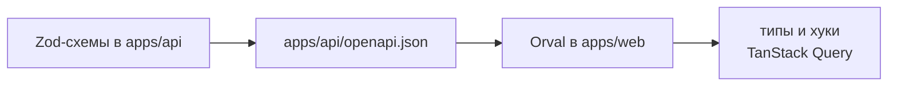

# 0009. HTTP-контракт: Zod-схемы → `openapi.json` → Orval

- **Статус:** принято
- **Дата:** 2026-11-18
- **Область:** api, web
- **Подготовил:** ИИ-агент по запросу foxprogs; направление согласовал foxprogs (2026-11-14)
- **Задача:** [KAN-13](https://project-group-11.atlassian.net/browse/KAN-13)

## Контекст

Фронтенд вызывает бэкенд по HTTP и генерирует клиент API через Orval. До этого решения у бэкенда не было описания API,
Orval ходил за схемой на запущенный бэкенд (`localhost:3001/api-json`), а шаг CI запускал бэкенд в фоне и глушил ошибку
(`|| true`) — то есть ничего не проверял. Нужно было решить три вещи: чем описывать запросы и ответы на бэкенде, где
лежит схема API и как CI ловит расхождение бэкенда и фронтенда.

Ограничения: команда маленькая, часть разработчиков — junior; Zod уже используется в монорепе (формы на фронтенде,
`@app/shared`); NestJS 12 и `@nestjs/swagger` 12.1 новее, чем большинство примеров в интернете.

## Варианты

Чем описывать запросы и ответы (DTO):

1. **Классы с декораторами `class-validator` и `@ApiProperty`** — классический способ NestJS. Плюсы: много примеров.
   Минусы: два новых пакета, отдельный от Zod инструмент, тип и валидация описываются дважды.
2. **Zod-схемы через Standard Schema** — `@nestjs/swagger` 12.1 принимает Zod-схему сам (`standardSchema`), валидацию
   делает встроенный `StandardSchemaValidationPipe`. Плюсы: один инструмент на всю монорепу, тип выводится из схемы
   (`z.infer`). Минусы: способ свежий, примеров мало.
3. **HTTP-схемы руками в `@app/shared`** — обе стороны импортируют одни и те же схемы. Плюсы: без генерации. Минусы:
   Swagger о них не знает, Orval не нужен, а значит и хуки TanStack Query пишутся руками; легко разойтись с реальным
   ответом бэкенда.

Где лежит схема API:

1. **Только на запущенном бэкенде** (`/api/docs-json`) — как было. Минусы: фронтендеру нужен бэкенд, CI должен его
   поднимать, изменение контракта не видно в PR.
2. **Файлом `apps/api/openapi.json` в репозитории**, бэкенд пишет его скриптом без запуска сервера. Плюсы: Orval и CI
   работают без бэкенда, изменение API видно в diff PR. Минусы: файл нужно не забыть пересоздать — это ловит CI.

## Решение

Выбраны Zod-схемы (вариант 2) и файл `openapi.json` в репозитории (вариант 2).

- **Схемы и ответы.** DTO — Zod-схема рядом с модулем (`src/health/health.schema.ts`). Ответ описывается
  `@ApiOkResponse({ standardSchema: XSchema })`, тип ответа — `z.infer<typeof XSchema>`. `@nestjs/swagger` сам
  переводит схему Zod в JSON Schema (OpenAPI 3.0), дополнительных пакетов не нужно.
- **`.meta({ id: 'X' })` у каждой DTO-схемы.** Без `id` схема встраивается в описание эндпоинта и не попадает в
  `components.schemas`, и Orval не создаёт для неё именованный тип. Проверено на `HealthStatus`.
- **Валидация входа** — `StandardSchemaValidationPipe` с `@Body({ schema })` / `@Param('id', { schema })`. Пока не
  подключена: у единственного эндпоинта нет тела и параметров. Подключается с первым таким эндпоинтом, тогда же
  проверить, как Swagger описывает тело запроса.
- **Генерация файла.** `pnpm --filter api openapi` собирает бэкенд (`nest build`) и запускает
  `src/generate-openapi.ts`: приложение создаётся без `init` и `listen` — порт не открывается, подключения к БД в
  `onModuleInit` не выполняются. Собирать нужно именно `nest build` (`tsc`): Swagger читает метаданные декораторов,
  которые запуск TypeScript «на лету» через esbuild не создаёт. Отдельную задачу в Turborepo не добавляли (решил
  foxprogs): команда одна, кэш для неё не нужен.
- **Orval** читает `../api/openapi.json`. Сгенерированный клиент (`apps/web/src/shared/api/generated/`) коммитится.
- **CI, шаг 8** пересоздаёт `openapi.json` и клиент и падает, если они отличаются от закоммиченных.
- **`@app/shared`** — только для того, чего Swagger не описывает: события WebSocket.

## Последствия

- Изменили эндпоинт или его схему — в том же PR `pnpm --filter api openapi`, `pnpm --filter web generate-api` и
  коммит обоих результатов. Иначе CI упадёт. Изменение контракта видно в diff `openapi.json`: его смотрит фронтендер,
  который будет вызывать эндпоинт.
- Генерация файла проверяет переменные окружения (`ConfigModule` при создании приложения). Обязательная переменная
  без значения по умолчанию (например, `DATABASE_URL`) уронит шаг 8 — для CI ей нужно будет задать значение.
- `pnpm --filter api openapi` пересобирает `dist/` и может на секунду помешать запущенному `pnpm dev:api`.
- `@nestjs/swagger` тянет `swagger-ui-dist`, а тот — `@scarf/scarf`, который при установке отправляет статистику.
  Отключено в корневом `package.json` (`"scarfSettings": { "enabled": false }`).
- Правила записаны в `apps/api/AGENTS.md` и [`docs/architecture.md`](../architecture.md#контракт-фронтенд--бэкенд).
