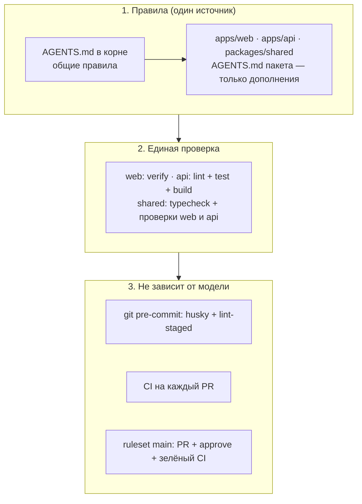

# ИИ-агенты: одни правила для всех вендоров

[← к документации](./README.md)

В команде работают разные ИИ-инструменты — Claude Code, Cursor, opencode, Codex / ChatGPT. Чтобы все они
работали по одним правилам, обвязка устроена в три слоя: **правила** → **единая проверка** → **принудительные
проверки**, которые не зависят от модели.

## 1. Правила — только в `AGENTS.md`

[`AGENTS.md`](https://agents.md/) — открытый формат инструкций для агентов, его читают большинство инструментов.
Правила лежат в двух уровнях:

| Файл                        | Что в нём                                                                                            |
| --------------------------- | ---------------------------------------------------------------------------------------------------- |
| `AGENTS.md` (корень)        | Карта монорепы, команды, критерий «готово», запреты, рабочий цикл, решения и ADR, git, учебный режим |
| `apps/web/AGENTS.md`        | Только фронтенд: команды, «готово», FSD, дизайн-система                                              |
| `apps/api/AGENTS.md`        | Только бэкенд: состояние, команды, «готово», соглашения NestJS                                       |
| `packages/shared/AGENTS.md` | Только общий контракт: что можно класть и как менять                                                 |

Правило уровня пакета **дополняет** корневое и не повторяет его. Повтор — это два места, которые разойдутся.

### Как это читают инструменты

| Инструмент                         | Что читает                                                                                                                                                                                              |
| ---------------------------------- | ------------------------------------------------------------------------------------------------------------------------------------------------------------------------------------------------------- |
| Claude Code                        | `CLAUDE.md`. В корне и в каждом пакете лежит `CLAUDE.md` из одной строки `@AGENTS.md` — он подключает `AGENTS.md` рядом. Вложенные `CLAUDE.md` Claude подгружает, когда работает с файлами в этой папке |
| Cursor                             | `AGENTS.md` (корень и вложенные), а также `.cursor/rules/`                                                                                                                                              |
| opencode                           | `AGENTS.md`                                                                                                                                                                                             |
| Codex (CLI, ChatGPT)               | `AGENTS.md` от корня репозитория до текущей папки                                                                                                                                                       |
| Чат ChatGPT / Claude.ai в браузере | Репозиторий не видит. Вставьте в чат нужный `AGENTS.md` или его часть сами                                                                                                                              |

Не все инструменты подгружают вложенные `AGENTS.md`, если агент запущен из корня. Поэтому в корневом `AGENTS.md`
есть правило: «перед изменениями в пакете прочитай его `AGENTS.md`». Если видите, что агент его не соблюдает, —
напишите первой фразой: «прочитай `apps/web/AGENTS.md`».

**Адаптеры — только однострочные.** `CLAUDE.md` содержит только `@AGENTS.md`. Своих правил в адаптеры не пишем,
иначе разные модели получат разные инструкции. Понадобится новый инструмент со своим файлом (например, `GEMINI.md`)
— добавьте такой же однострочный адаптер и строку в таблицу выше.

> Поддержка форматов у инструментов меняется. Подключили новый инструмент — проверьте в его документации, какой
> файл он читает, и обновите таблицу.

### Откуда запускать агента

- Задача в одном пакете — можно запускать из его папки (`apps/web`) или из корня: правила подтянутся в обоих
  случаях.
- Задача на несколько пакетов (новый эндпоинт + экран, изменение `@app/shared`) — **из корня**.

## 2. Единая проверка

Формулировки «проверь, что всё работает» каждая модель понимает по-своему. Поэтому «готово» определено
командами с однозначным результатом:

| Пакет             | Команда                                                                       |
| ----------------- | ----------------------------------------------------------------------------- |
| `apps/web`        | `pnpm --filter web verify` (typecheck + ESLint + steiger + Prettier + Vitest) |
| `apps/api`        | `pnpm --filter api lint && pnpm --filter api test && pnpm --filter api build` |
| `packages/shared` | `pnpm typecheck && pnpm build` + проверки `web` и `api`                       |

`AGENTS.md` требует запускать их перед завершением задачи и прикладывать итог к отчёту. Ревьюер может повторить
ту же команду и получить тот же результат.

## 3. Проверки, которые нельзя «уговорить»

Правила в тексте модель может неправильно понять или пропустить. Поэтому главное продублировано механизмами,
которые срабатывают независимо от того, кто пишет код — человек или любая модель:

| Механизм                             | Что ловит                                                                                      | Где                                               |
| ------------------------------------ | ---------------------------------------------------------------------------------------------- | ------------------------------------------------- |
| **pre-commit** (husky + lint-staged) | ESLint и Prettier по изменённым файлам — **пока только `apps/web`**                            | `.husky/pre-commit`, `apps/web/.lintstagedrc.mjs` |
| **steiger** в `lint`                 | нарушения слоёв FSD и публичного API                                                           | `apps/web/steiger.config.mjs`                     |
| **TypeScript strict**                | `any`, непроверенные `null`, неверные типы                                                     | `tsconfig.json` пакетов                           |
| **MSW в строгом режиме**             | тесты фронтенда, которые ходят в сеть                                                          | `apps/web/vitest.setup.ts`                        |
| **CI**                               | lockfile, typecheck, lint, сборка. Тестов и Prettier в CI пока нет — гоняйте проверки локально | `.github/workflows/ci.yml`                        |
| **Ruleset `main`**                   | прямые пуши, PR без approve или с красным CI                                                   | настройки GitHub                                  |
| **CodeRabbit**                       | ИИ-ревью PR по тем же `AGENTS.md`                                                              | `.coderabbit.yaml`                                |

Нашли повторяющуюся ошибку агентов — сначала подумайте, можно ли поймать её **проверкой** (правило линтера, тест,
настройка steiger, шаг CI), и только если нельзя — дописывайте правило в `AGENTS.md`.

## Как менять правила

- Правило касается всего проекта (git, «готово», запреты) → корневой `AGENTS.md`.
- Правило касается одного пакета → `AGENTS.md` этого пакета.
- Правило меняет то, что описано в `docs/`, → обновите и документ, и `AGENTS.md` в одном PR.
- Держите `AGENTS.md` коротким: агент читает его целиком в каждой сессии. Подробности и примеры — в `docs/`, а в
  `AGENTS.md` — ссылка.
- Блок `<!-- BEGIN:nextjs-agent-rules -->` в `apps/web/AGENTS.md` пишет сам `next dev` — не удаляйте его, коммитьте
  как есть. Опция `experimental.agentFeedback` в `next.config.ts` выключена: она добавляла блок, который просил
  агентов отправлять отзывы о Next.js в Vercel, а это противоречит запрету отправлять данные во внешние сервисы.
