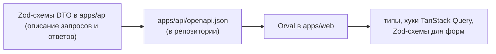

# Контракт API: Swagger → `openapi.json` → Orval

[← к бэклогу](./README.md) · Jira: —

## Зачем

Фронтенд генерирует клиент API через Orval из Swagger-схемы бэкенда. Сейчас:

- `@nestjs/swagger` в `apps/api` не установлен — схемы нет, генерировать не из чего;
- Orval ходит за схемой на запущенный бэкенд (`http://localhost:3001/api-json`), поэтому фронтендеру нужно поднимать
  бэкенд, а проверка в CI запускает его в фоне и глушит ошибки.

## Направление

Предложил ИИ-агент, согласовал foxprogs (2026-11-14). В PR этой задачи оформляется ADR — с тем, что выяснится при
подключении.

- **HTTP-контракт описывает бэкенд** — DTO в `apps/api`. Swagger строится из DTO, не из моделей Prisma.
- **DTO — Zod-схемы**, а не классы с `class-validator`: один инструмент для HTTP, WebSocket и форм на фронтенде.
  Валидация — встроенный `StandardSchemaValidationPipe` из `@nestjs/common`; `@nestjs/swagger` 12.1 умеет строить
  схему из Standard Schema (Zod 4 её поддерживает). Минус — способ свежий, примеров мало, поэтому первым делается
  эталонный эндпоинт.
- **Схема лежит файлом в репозитории** (`apps/api/openapi.json`), бэкенд пишет её скриптом без запуска сервера.
  Изменение контракта видно в diff PR.
- **Orval генерирует из файла**, бэкенд для этого не нужен.
- **CI** перегенерирует схему и клиент и падает, если они отличаются от закоммиченных.
- **`@app/shared`** — не для HTTP, а для того, чего Swagger не описывает: события WebSocket
  (см. [socket-events.md](./socket-events.md)).

## Уточнить при реализации

- [ ] Точный способ подключения Zod к `@nestjs/swagger` и к пайпу валидации — по документации установленной версии.
- [ ] Ревью контракта: PR, меняющий `openapi.json`, смотрит фронтендер, который будет вызывать эндпоинт (отметить
      его в PR). Обязательным через `CODEOWNERS` пока не делаем, чтобы PR не застревали.

Новые пакеты (`@nestjs/swagger` и др.) — только после согласия команды (правило из `AGENTS.md`).

## Что сделать

- [ ] Установить и подключить Swagger в `apps/api`.
- [ ] Скрипт генерации `openapi.json` без запуска сервера + задача в turbo.
- [ ] `apps/web/orval.config.ts`: `input` — путь к файлу вместо URL.
- [ ] `apps/web/src/shared/api/session.ts` проверяет ответ через `UserSchema` из `@app/shared` — заменить на
      сгенерированную схему (то же в тесте `features/auth/model/schemas.test.ts`), `UserSchema` из `@app/shared`
      удалить.
- [ ] Шаг 8 в CI: честная проверка без `|| true` и без запуска бэкенда.
- [ ] ADR о контракте, обновить `docs/architecture.md`, `README.md`,
      `apps/web/docs/tooling.md`, `packages/shared/AGENTS.md`, `apps/api/AGENTS.md`.
- [ ] Первый реальный эндпоинт как образец для команды и правило в `apps/api/AGENTS.md` «делай как в нём».
