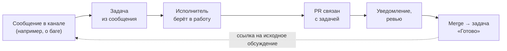
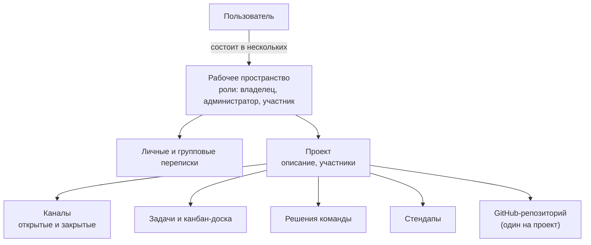
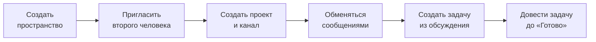

# Продукт: что мы строим

[← к документации](./README.md)

Пересказ технического задания курса своими словами: что за продукт, из чего он состоит, какие требования к поведению и
качеству и в каком порядке делаем. Оригинал ТЗ в репозиторий не кладём — он есть у команды. Пересказ подготовил
ИИ-агент по просьбе foxprogs (2026-11-14); если что-то здесь расходится с оригиналом, прав оригинал — поправьте файл.

Это **направление**, а не список задач. Задачи — в Jira (`KAN-*`), технические заготовки — в
[бэклоге](./backlog/README.md).

## Суть

Рабочий мессенджер для команд разработки — в духе Slack, но с задачами, канбан-доской и интеграцией с GitHub. Главное
отличие от обычного чата: **переписка связана с работой**. Договорённости не теряются в ленте, а превращаются в задачи и
решения, а результат работы (PR, ревью, merge) возвращается обратно в обсуждение.

Главная цепочка, ради которой всё делается:

Если чат, доска и уведомления о PR работают по отдельности и не помогают друг другу — задача проекта не решена.

Результат: открытый репозиторий на GitHub и приложение, развёрнутое на сервере. Ориентир по удобству — Slack, но
повторять его целиком не нужно.

## Модель предметной области

- Пользователь может состоять в нескольких пространствах. В пространство приглашают; приглашение можно отозвать,
  участника — удалить или сменить ему роль.
- Внутри пространства — проекты (например, сайт и мобильное приложение одной команды).
- Открытый канал доступен всем участникам проекта, в закрытый попадают только по приглашению. Канал можно
  переименовать, изменить описание, заархивировать.
- **Кто что может** (создавать проекты, приглашать, управлять каналами, подключать GitHub, настраивать стендапы) —
  решаем сами. Это решение нужно до основной разработки: [бэклог — модель прав](./backlog/domain-model.md).

## Функции

Очередь: **1** — стартовый сценарий (см. [Порядок работы](#порядок-работы)), **2** — после него, **★** — по желанию.

| Область                       | Очередь | Коротко                                                                   |
| ----------------------------- | ------- | ------------------------------------------------------------------------- |
| Вход, лендинг, личный кабинет | 1       | Аутентификация и авторизация, лендинг, профиль и настройки                |
| Пространства, проекты, каналы | 1       | Модель выше, роли, приглашения                                            |
| Общение                       | 1       | Каналы, личные и групповые переписки в реальном времени                   |
| Задачи из обсуждений          | 1       | Задача из сообщения или отдельно, связь с исходным обсуждением            |
| Канбан                        | 1       | Доска проекта, статусы, перемещение в реальном времени                    |
| Уведомления                   | 2       | Центр уведомлений, настройки, «Не беспокоить», Telegram-бот               |
| Интеграция с GitHub           | 2       | Уведомления о PR и CI, связь задачи с PR, автоматические переходы         |
| Асинхронные стендапы          | 2       | Расписание, напоминания, ответы за день, сводка от ИИ                     |
| Решения команды               | 2       | Сообщение или ветка → решение, вкладка решений проекта, история замен     |
| ИИ-помощник                   | 2       | Пересказ, ответы по данным проекта со ссылками, черновики задач и отчётов |
| Голосовые комнаты             | ★       | Только когда основное работает стабильно; готовое решение на WebRTC       |

### Общение

- Сообщения в реальном времени; базовое форматирование: выделение, списки, ссылки, блоки кода.
- Своё сообщение можно изменить (появляется отметка «изменено») и удалить.
- Ветки ответов под сообщением — отдельно от основной ленты. Реакции. Упоминания людей с уведомлением.
- Закреплённые сообщения в канале и личное «Избранное».
- Файлы и изображения, у изображений — предпросмотр.
- Поиск по сообщениям с фильтрами: проект, канал, автор, дата.
- История подгружается порциями при прокрутке вверх.
- Счётчики непрочитанных, упоминания считаются отдельно; переход к первому непрочитанному.
- Кто в сети и кто сейчас печатает.
- После потери связи клиент переподключается и получает всё, что пропустил.
- У отправляемого сообщения видно состояние; не ушло — ошибка и кнопка «повторить».

### Задачи и канбан

- Задачу создают из сообщения (ссылка на обсуждение сохраняется) или отдельно.
- Поля: идентификатор, название, описание, автор, исполнитель, статус, приоритет, срок, чеклист.
- В сообщении видно, что по нему есть задача, и её текущий статус; из задачи можно вернуться к сообщению.
- К задаче прикрепляют файлы и связанные сообщения. Обсуждение задачи — отдельная ветка, доступная и из карточки, и
  из канала. Задачу можно упомянуть в сообщении.
- История изменений: кто поменял статус, срок, описание, исполнителя (в том числе автоматические переходы от GitHub).
- Доска у каждого проекта. Базовые колонки: «Нужно сделать», «В работе», «На проверке», «Готово»; колонки
  настраиваются, порядок карточек внутри колонки сохраняется.
- Фильтры по исполнителю, приоритету, сроку. Изменения на доске видят все участники сразу.
- Задачу можно пометить заблокированной с причиной («ждём API от бэкенда»).
- Уведомления: назначили задачу, подходит срок, появилась блокировка.
- Раздел «Моя работа»: мои задачи из всех проектов, запросы на ревью, упоминания.
- Спринтов, сложных workflow, учёта времени и отчётов как в Jira **не делаем**.

### GitHub

- К проекту подключается один репозиторий и выбирается канал для уведомлений. Подключает только тот, у кого есть право.
- Уведомления: открыт PR, запрошено ревью, результат CI, merge. В сообщении о PR — автор, название, ссылка, проверки.
- Задача связывается с PR (идентификатор задачи в описании PR или ссылка вручную); в карточке задачи — связанные PR и
  их состояние.
- Простые правила: PR открыт → «На проверке», PR влит → «Готово». Нужно продумать случай нескольких PR у одной задачи.
- Подпись входящих webhook проверяется всегда; повторная доставка того же webhook не создаёт дублей и не повторяет
  действия.
- Токены и секреты не попадают во фронтенд, в сообщения и в логи. Данные закрытого репозитория видят только те, кому
  разрешено: подключение репозитория не открывает его всему пространству.

### Стендапы и решения

- Администратор проекта задаёт расписание, часовой пояс и вопросы («Что сделал?», «Что планирую?», «Что мешает?»).
  Участникам приходит напоминание; в ответе можно сослаться на задачи и PR.
- Ответы за день собираются в одно обсуждение; видно, кто ответил, а кто нет; история доступна участникам проекта.
- ИИ делает сводку: что продвинулось, где блокировки, кому нужна помощь — со ссылками на ответы.
- Решение — не задача: «Используем PostgreSQL, потому что…». Сообщение или ветку сохраняют как решение (название,
  описание, автор, дата, ссылка на обсуждение). Решения — на отдельной вкладке проекта, связываются с задачами.
- Решение можно заменить новым, сохранив историю и причину замены. ИИ может предложить черновик, сохраняет человек.

### ИИ в приложении

- Пересказ пропущенного обсуждения; ответы на вопросы по сообщениям, задачам и решениям («почему выбрали эту
  библиотеку?», «что блокирует релиз?»); сводка по проекту; черновик недельного отчёта по стендапам, задачам и GitHub;
  предложение задач по итогам обсуждения.
- В ответах — ссылки на источники, чтобы их можно было проверить. Не хватает данных — ИИ так и говорит.
- **Права доступа те же, что у пользователя**: через ИИ нельзя достать закрытый канал, чужой проект или закрытый
  репозиторий.
- У генерации видно состояние: идёт, готово, ошибка.
- ИИ ничего не меняет и не отправляет от имени пользователя без его подтверждения (задачи, решения, сообщения).
- Продумать, что происходит с поиском и ответами ИИ, когда исходные данные изменили или удалили.

### Уведомления

- Единый центр: упоминания, назначенные задачи, ответы в ветках, запросы ревью — с переходом к сообщению, задаче или
  PR.
- Настройки по каналам и проектам, режим «Не беспокоить», рабочие часы с часовым поясом.
- Telegram-бот: напоминания о стендапе, назначения, упоминания, запросы ревью.
- Прочитал в одной вкладке — обновилось во всех.
- Продумать, что отправлять сразу, что откладывать и как не слать одно и то же несколько раз.

### Голосовые комнаты (★)

Комната внутри канала: подключиться, выключить микрофон, выйти; видно участников и того, кто говорит; демонстрация
экрана; в комнату закрытого канала не попадают посторонние; обработка потери связи, запрета микрофона, окончания
демонстрации. Во время разговора можно открыть задачу, итоги — записать и превратить в задачи. Медиасервер не пишем.

## Сквозные требования к поведению

Эти требования касаются сразу нескольких функций и обеих частей монорепы — их легко потерять, если смотреть только на
свою задачу.

- **Сообщения не теряются, не дублируются и не меняют порядок.** Повторная отправка после сетевой ошибки не создаёт
  дубль (у сообщения есть id от клиента). История хранится в БД — WebSocket-соединение не хранилище.
- **Получено ≠ прочитано.** Это разные события. Прочитал канал в одной вкладке — счётчики обновились в остальных.
- **Онлайн при нескольких вкладках.** Закрытие одной вкладки не делает пользователя офлайн, пока открыта другая.
- **Права проверяются везде**: в HTTP, в событиях WebSocket, в поиске, при скачивании файлов, в запросах к ИИ.
  Удалённый из закрытого канала перестаёт получать его сообщения сразу, даже через уже открытое соединение. Ссылка на
  вложение не даёт скачать приватный файл постороннему.
- **Повторный запуск безопасен**: webhook, напоминания, автоматические переходы задач можно выполнить дважды без
  последствий.
- **Несколько инстансов бэкенда.** В проде бэкенд запущен в нескольких экземплярах: пользователи, подключённые к разным
  инстансам, должны видеть сообщения, присутствие и изменения друг друга.
- **Ошибки видны.** Не отправилось сообщение, не сохранилось изменение задачи — интерфейс показывает реальное состояние
  и даёт повторить.

## Требования к коду

Стек в ТЗ рекомендованный, менять его можно — но через [ADR](./adr/README.md). Тесты обязательны хотя бы на основную
логику. Код ревью — у каждой задачи ([workflow](./workflow.md)).

**Фронтенд** ([`apps/web`](../apps/web/README.md), что за что отвечает — [`stack.md`](../apps/web/docs/stack.md)):

- Next.js, TypeScript, TanStack Query, Zustand, shadcn + Tailwind, react-hook-form + Zod, socket.io, библиотека
  drag-and-drop; ESLint, Prettier, husky, Sentry, Vitest + RTL, Storybook; FSD с линтером.
- Стили — из UI-кита, минимум своих стилей по месту.
- Канал с тысячами сообщений открывается и прокручивается без зависаний.
- Новое сообщение не перебрасывает вниз, если пользователь читает историю.
- Одновременное перемещение карточек несколькими людьми не теряет карточки.
- У состояния интерфейса, данных с сервера и состояния WebSocket — понятные и разные места хранения
  ([`state-and-data.md`](../apps/web/docs/state-and-data.md)).

**Бэкенд** ([`apps/api`](../apps/api/README.md)):

- NestJS, TypeScript, socket.io, PostgreSQL, Redis, Prisma или TypeORM (выбрать — ADR), BullMQ, Swagger, пакет
  `openai`; S3-совместимое хранилище файлов. Для поиска и подготовки контекста для ИИ можно взять дополнительные
  инструменты.
- Модульная архитектура и слои внутри модулей.
- Тяжёлое — в фоновых задачах: обработка файлов, индексация для поиска, генерация ИИ.
- Ограничения: размер файлов, частота сообщений, запросы к ИИ.
- В логах нет токенов интеграций и содержимого приватных переписок.

Что из этого уже установлено — смотрите `package.json` пакета. Новые пакеты ставим только после согласия команды
([`AGENTS.md`](../AGENTS.md)).

## Инфраструктура и процесс

- **Git**: trunk-based, прямой push в `main` запрещён, только PR с ревью ([ADR-0003](./adr/0003-trunk-based-development.md)).
- **CI** на каждый PR: линтеры, тесты, сборка, typecheck ([бэклог](./backlog/ci-checks.md)).
- **Релиз**: отдельная ветка и кнопка release в GitHub, выкладка в прод — одним действием
  ([бэклог](./backlog/release.md)).
- **Docker** обязателен и для локальной разработки, и для прода ([бэклог](./backlog/docker.md)).
- **Прод**: несколько инстансов бэкенда; логи и метрики обязательны — Loki + Promtail, Prometheus, node_exporter,
  cAdvisor, Grafana.
- **Переменные окружения**: `.env` локально, секреты GitHub в CI/CD; секреты в репозиторий не попадают.
- **Документация**: как запустить проект, какие переменные нужны, особенности — в README и `docs/`.
- **ИИ в разработке** используем по максимуму: код, ревью, тесты, сценарии для агентов, DevOps. Но маленькими шагами,
  с ревью и понятными зонами ответственности — не «весь проект одним промптом» и не коммиты на тысячи строк.

## Порядок работы

**До основной разработки:**

1. Решить модель пространств, проектов, каналов и прав доступа — [бэклог](./backlog/domain-model.md).
2. Проверить на маленьком прототипе обмен сообщениями между двумя клиентами и восстановление соединения —
   [бэклог](./backlog/realtime-prototype.md).
3. Разбить проект на блоки, которые можно делать параллельно (эпики в Jira).

**Стартовый сценарий** — первое, что должно работать от начала до конца:

**Дальше** — GitHub, стендапы, решения команды, ИИ-помощник, уведомления. Голосовые комнаты — только после того, как
основное стабильно работает; без них проект считается завершённым.

## Что ещё не решено

| Вопрос                                    | Где                                                  |
| ----------------------------------------- | ---------------------------------------------------- |
| Модель прав: кто что может в пространстве | [backlog/domain-model.md](./backlog/domain-model.md) |
| Способ входа и хранение сессии            | [backlog/auth.md](./backlog/auth.md)                 |
| ORM: Prisma или TypeORM                   | ADR при подключении БД                               |
| Схема веток релиза                        | [backlog/release.md](./backlog/release.md)           |
| Поиск и подготовка контекста для ИИ       | ADR, когда дойдём до поиска                          |

## Для ИИ-агентов

- Читайте этот файл, чтобы понимать, **зачем** нужна задача и с чем она связана. Делайте только то, что в задаче: не
  добавляйте функции «на будущее» из этого списка.
- Если задача противоречит этому файлу или задевает нерешённый вопрос из таблицы выше — не решайте сами, предложите
  варианты и спросите.
- Сквозные требования (права, дубли, несколько вкладок и инстансов) учитывайте в каждой задаче, которую они касаются, —
  и упоминайте в отчёте, если что-то из них не покрыто.
